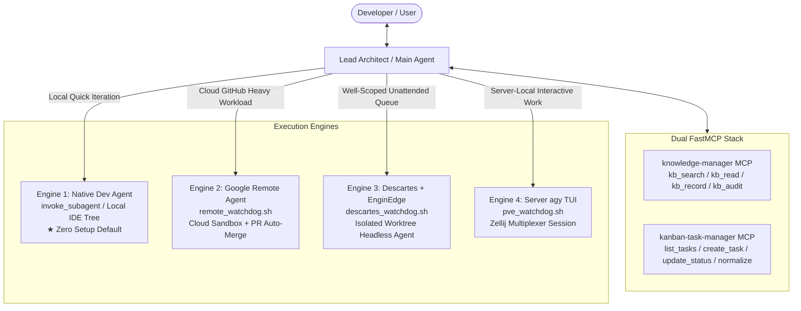

# agy-disciple 🚀

[English](README.md) | [简体中文](README_zh.md)

[](LICENSE)
[](https://antigravity.google)
[](https://github.com)

> **A Production-Grade Multi-Agent Development Team Plugin for Google Antigravity (AGY)**  
> Transform single-threaded agent interactions into a disciplined, hierarchical engineering squad: Lead Architect, Dev, Merger, and Ops.

---

## 1. 📖 Overview

Standard AI coding assistants operate as monolithic single agents. When faced with complex features or large refactors, developers frequently face critical bottlenecks:
* **Context Window Pollution**: Raw compile logs, test stack traces, and trial-and-error debugging flood the main architectural conversation context;
* **Source Code Corruption**: Agents directly mutate production source files, risking broken working trees and hallucinated deletions;
* **Repeated Anti-Patterns**: Without negative knowledge tracking, agents repeatedly suggest dead-end solutions previously proven broken;
* **Unattended Execution Gaps**: Standard sessions pause waiting for interactive approvals and lack headless autonomous workflows when developers go off work.

`agy-disciple` (**Antigravity Disciple**) solves these challenges with a **hierarchical multi-agent engineering workflow**. It positions the main agent as a **Lead Architect & Project Manager**, orchestrating specialized sub-agents and execution engines while maintaining strict architectural governance:

- **Zero-Dependency Native Intelligence (Default)**: Out-of-the-box local and remote development via native `dev` agents and the `agy` CLI;
- **Google Cloud Remote Agent (`remote_watchdog.sh`)**: Direct Mac-to-Cloud or server-routed cloud sandbox execution (`agy --remote-agent`) with autonomous defenses and PR auto-merge;
- **Descartes + EnginEdge Engine (`descartes_watchdog.sh` / `descartes-dispatch`)**: Headless, worktree-isolated AST-level autonomous coding without requiring GitHub round-trips;
- **Dual FastMCP Stack**: Data-driven task tracking (`kanban-task-manager`) with automatic sequence numbering (`_001`..`_NNN`) and single-source-of-truth knowledge management (`knowledge-manager`) with automated graveyard anti-pattern auditing;
- **Draft Suffix Isolation**: All coding changes are generated in draft files (`<basename>_task_<name>.<ext>`) and safely merged only after human or test verification.

---

## 2. 🏛️ Core Architecture & Execution Engines

`agy-disciple` provides a multi-engine architecture adapted to your workflow requirements:



| Engine | Execution Host | Best For | Prerequisites |
| :--- | :--- | :--- | :--- |
| **Native `dev`** *(Default)* | Local IDE conversation tree (`invoke_subagent`) | Fast iterations, bug fixes, interactive code review | Zero setup; built into Antigravity IDE |
| **Google Remote Agent** | Google Cloud Sandbox (`remote_watchdog.sh`) | Heavy multi-file tasks on GitHub-backed repositories, PR auto-merge | GitHub CLI (`gh`), Antigravity account |
| **Descartes + EnginEdge** | Remote server worktree (`descartes_watchdog.sh`) | Well-scoped single-module tasks (≤50 turns), unattended night queues | `enginedge` binary, server SSH access |
| **Server `agy` TUI** | Remote server Zellij session (`pve_watchdog.sh`) | Server-local hardware/databases, long-running interactive services | SSH access, `zellij`, remote `agy` |

---

## 3. 🌐 Project Environment Topologies

`agy-disciple` supports three project topologies:

1. **`Local`**: Source code is hosted on the local machine (with optional remote test environment). Code is written via `dev-manager` or direct Mac-to-Cloud Remote Agent.
2. **`PVE-Native` / `Server-Native`**: Authoritative source code lives on a remote Linux server (mirrored to local client via Mutagen). Managed via `pve-dispatch` across Descartes, Remote Agent, and Server `agy`.
3. **`Pure-Remote` (Mode B)**: Cloud-first project developed in Google Cloud Remote Projects (`/workspace/<project>`) with zero local source clones. Scaffolded via `pure-remote-init`, migrated via `local-to-remote-migration`.

---

## 4. 🚦 Quick Start

Verify your environment anytime with the built-in diagnostic doctor:
```bash
python configure.py --doctor
```

### Installation

Clone the plugin into your Antigravity plugin directory:
```bash
cd ~/.gemini/config/plugins/
git clone https://github.com/catclever/agy-disciple.git
```
*(Or place it inside your workspace `.agents/plugins/agy-disciple`)*.

### Preset Selection

Switch between configuration presets in one command:

```bash
# 1. Standalone / Local-First / In-Repo (Default)
python configure.py --preset=standalone

# 2. Remote Server / Centralized Metadata
python configure.py --preset=server-centralized

# Inspect current configuration status
python configure.py --status
```

---

## 5. 🛠️ FastMCP Server Setup

`agy-disciple` bundles two high-performance FastMCP servers:

1. **`kanban-task-manager`**:
   - Automatic sequential numbering (`_001`..`_NNN`)
   - Resilient task lookup by slug, number, or filename
   - Rich Markdown body scaffolding and `update_task_content`
   - Global status normalization across projects
2. **`knowledge-manager`**:
   - `kb_search`: Fuzzy and token-based search across active cards and anti-pattern graveyard
   - `kb_read`: Safe path-traversal-free document retrieval
   - `kb_record`: Automatic YAML Frontmatter formatting and index synchronization (`knowledge.md`, `graveyard/grave.md`)
   - `kb_audit`: Pre-presentation design audit against recorded failures

Add them to `~/.gemini/antigravity/mcp_config.json`:

```json
{
  "mcpServers": {
    "kanban-task-manager": {
      "command": "uv",
      "args": [
        "run",
        "--with",
        "mcp",
        "--with",
        "pyyaml",
        "/path/to/agy-disciple/mcp/kanban-task-manager/server.py"
      ]
    },
    "knowledge-manager": {
      "command": "uv",
      "args": [
        "run",
        "--with",
        "mcp",
        "--with",
        "pyyaml",
        "/path/to/agy-disciple/mcp/knowledge-manager/server.py"
      ]
    }
  }
}
```

---

## 6. 🌙 Night Shift: Autonomous Overnight Coding

When you log off, trigger `night-shift` to keep development moving forward:

- **Path A (Descartes Autonomous Pipeline)**:
  Runs serial tasks in isolated git worktrees on your server with `--auto-merge`. Each task is squashed into a clean commit (`feat(descartes): <Task_ID>`) that can be reverted with one command if needed.
- **Path B (Google Remote Agent Autonomous Pipeline)**:
  Dispatches tasks to the Google Cloud Sandbox with multi-account rotation and PR auto-merge.
- **Path C (Antiverse Zellij Master Session)**:
  Hands off master coordination to an unattended agent session inside Zellij (`antiverse-run`).

---

## 7. 📄 License

MIT License. See [LICENSE](LICENSE) for details.
