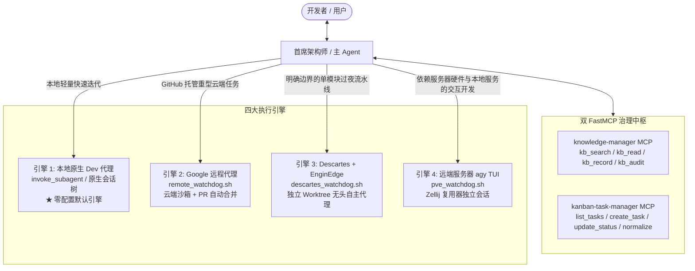

# agy-disciple 🚀

[English](README.md) | [简体中文](README_zh.md)

[](LICENSE)
[](https://antigravity.google)
[](https://github.com)

> **为 Google Antigravity (AGY) 量身定制的生产级多智能体分层研发团队插件**  
> 将单线程 Agent 交互转变为严谨、专业的分层工程战队：主架构师 (Lead Architect)、开发小弟 (Dev)、合并代理 (Merger) 与运维代理 (Ops)。

---

## 1. 📖 概述

标准的 AI 编码助手通常采用单 Agent 扁平模式。在面对复杂功能演进或跨模块重构时，开发者往往面临严峻痛点：
* **上下文窗口污染 (Context Pollution)**：冗长的编译输出、测试报错堆栈和反复试错日志充斥主对话，导致关键架构规范与长程记忆被冲刷；
* **生产代码直接破坏 (Code Corruption)**：Agent 直接在生产源文件上“试错修改”，极易导致工作区变脏、未验证代码泄漏甚至误删文件；
* **重复踏入反模式 (Graveyard Amnesia)**：缺乏对“失败探索”与“踩坑记录”的有效追踪，Agent 经常重复提出已被证明不可行的技术方案；
* **夜间无人值守断层**：标准交互在遇到权限或方案确认时会挂起等待人工输入，无法在开发者下班后实现全自动过夜研发流水线。

`agy-disciple` (**Antigravity 弟子**) 通过**分层智能体研发工作流**彻底解决这些问题。它将主对话确立为**首席架构师与项目管理者 (Lead Architect)**，负责需求拆解、知识沉淀与全局统筹，并将具体重体力编码委托给多类执行引擎：

- **零依赖原生智能 (默认引擎)**：开箱即用，通过 Antigravity 原生子代理 (`invoke_subagent`) 与 `agy` CLI 驱动开发；
- **Google Cloud 远程代理 (`remote_watchdog.sh`)**：支持本地 Mac 直连云端或服务器路由的多账号云沙箱执行 (`agy --remote-agent`)，具备三重防呆自愈机制与 GitHub PR 自动合并；
- **Descartes + EnginEdge 引擎 (`descartes_watchdog.sh` / `descartes-dispatch`)**：基于 AST 级代码分析与独立 Git Worktree 隔离的无头自主编码引擎，免除 GitHub 往返依赖；
- **双 FastMCP 架构**：内置数据驱动的任务追踪服务 (`kanban-task-manager`，支持 `_001`..`_NNN` 自动递增与韧性查询) 与知识管理防坑公墓服务 (`knowledge-manager`，支持方案呈现前的自动化反模式审计)；
- **草稿后缀隔离 (`Draft Suffix Rule`)**：所有代码变更均生成在独立的草稿文件 (`<basename>_task_<name>.<ext>`) 中，经测试或人工验收后由专门的合并代理原子化替换，确保生产源码安全。

---

## 2. 🏛️ 核心架构与多执行引擎

`agy-disciple` 构建了适应不同算力场景的四阶执行矩阵：



| 执行引擎 | 运行宿主 | 适用场景 | 核心前置依赖 |
| :--- | :--- | :--- | :--- |
| **原生 `dev`** *(默认)* | 本地 IDE 会话树 (`invoke_subagent`) | 快速迭代、局部排错、交互式审查 | 零配置；内置于 Antigravity IDE |
| **Google 远程代理** | Google Cloud 云端沙箱 (`remote_watchdog.sh`) | 托管于 GitHub 的大型多文件任务、自动提 PR 与合入 | GitHub CLI (`gh`), Antigravity 账号 |
| **Descartes + EnginEdge** | 远端服务器独立 Worktree (`descartes_watchdog.sh`) | 边界明确的单模块任务 (≤50 轮)、过夜免 GitHub 流水线 | `enginedge` 二进制, 服务器 SSH 访问 |
| **服务器 `agy` TUI** | 远端服务器 Zellij 会话 (`pve_watchdog.sh`) | 依赖服务器特定硬件/数据库、长程交互式服务调试 | SSH 连通, `zellij`, 远端 `agy` |

---

## 3. 🌐 三大项目环境拓扑

`agy-disciple` 原生支持三种拓扑规范：

1. **`Local` (本地优先模式)**：源码存放在本地工作区（可选配置远端按需测试环境）。通过 `dev-manager` 或 Mac 本地直发云端远程代理运行；
2. **`PVE-Native` / `Server-Native` (服务器原生模式)**：代码基准存放在远端服务器（通过 Mutagen 双向同步镜像至本地作为哑编辑器）。通过 `pve-dispatch` 统一分流至 Descartes、Remote Agent 或远端 `agy`；
3. **`Pure-Remote` (Mode B 纯远程模式)**：面向云端 Google Antigravity Remote Projects (`/workspace/<project>`) 的云原生模式，本地零源码克隆。支持通过 `pure-remote-init` 脚手架一键生成，或通过 `local-to-remote-migration` 将本地旧项目平滑迁移至云端。

---

## 4. 🚦 快速开始

运行内置的环境诊断工具，检查所有组件与依赖健康状态：
```bash
python configure.py --doctor
```

### 安装插件

将插件克隆至 Antigravity 插件目录：
```bash
cd ~/.gemini/config/plugins/
git clone https://github.com/catclever/agy-disciple.git
```
*(或克隆至项目本地的 `.agents/plugins/agy-disciple`)*。

### 预设一键切换

通过预设脚本轻松切换技能配置：

```bash
# 1. 独立单机 / 本地优先 / 仓库内元数据 (默认开箱预设)
python configure.py --preset=standalone

# 2. 远端服务器 / 集中式元数据
python configure.py --preset=server-centralized

# 查看当前生效的技能配置状态
python configure.py --status
```

---

## 5. 🛠️ 双 FastMCP 服务配置

`agy-disciple` 内置了两个高性能 FastMCP 服务端：

1. **`kanban-task-manager`**：
   - 自动生成三位自增序号 (`_001`..`_NNN`)，严禁人工手写序号；
   - 支持纯语义 slug、序列号或文件名的韧性定位；
   - 任务卡片 Markdown 模板脚手架与 `update_task_content` 内容追加；
   - 全局跨项目任务状态自动标准化。
2. **`knowledge-manager`**：
   - `kb_search`：对正面知识卡片与防坑公墓（Graveyard）进行模糊与分词搜索；
   - `kb_read`：安全的路径遍历防护文档读取；
   - `kb_record`：自动格式化 YAML Frontmatter 并原子化同步 `knowledge.md` 或 `grave.md` 索引；
   - `kb_audit`：在方案向用户呈现前，自动比对负面防坑记录，严防重蹈覆辙。

在 `~/.gemini/antigravity/mcp_config.json` 中配置挂载：

```json
{
  "mcpServers": {
    "kanban-task-manager": {
      "command": "uv",
      "args": [
        "run",
        "--with",
        "mcp",
        "--with",
        "pyyaml",
        "/path/to/agy-disciple/mcp/kanban-task-manager/server.py"
      ]
    },
    "knowledge-manager": {
      "command": "uv",
      "args": [
        "run",
        "--with",
        "mcp",
        "--with",
        "pyyaml",
        "/path/to/agy-disciple/mcp/knowledge-manager/server.py"
      ]
    }
  }
}
```

---

## 6. 🌙 Night Shift: 夜间狂暴模式 (无人值守研发)

下班离线时，唤起 `night-shift` 即可平滑将未完成任务转交至后台：

- **路径 A (Descartes 自主流水线)**：
  在远端独立 Git Worktree 中串行执行排队任务并附带 `--auto-merge`。每个任务生成单个清晰的 squash 提交 (`feat(descartes): <Task_ID>`)，遇错支持一键 `git revert`。
- **路径 B (Google 远程代理流水线)**：
  将任务队列分发至 Google Cloud 沙箱，配合多账号自动轮换锁与 GitHub PR 自动 Squash 合并。
- **路径 C (Antiverse Zellij 交互式主控)**：
  在服务器独立会话中唤醒无人值守主代理 (`antiverse-run`)，彻夜执行复杂的多智能体编排。

---

## 7. 📄 开源许可证

本项目采用 MIT 许可证。详见 [LICENSE](LICENSE) 文档。
